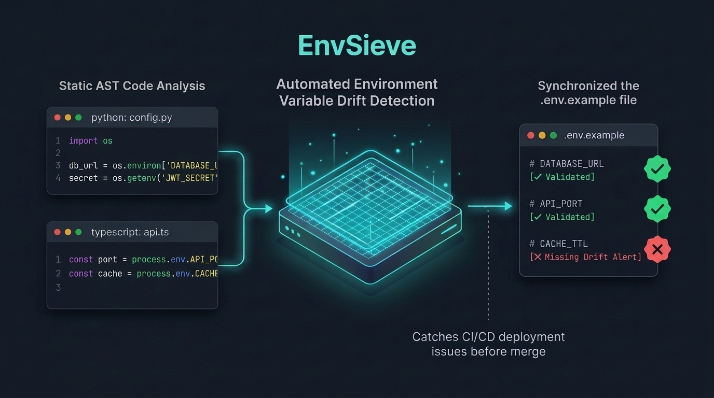
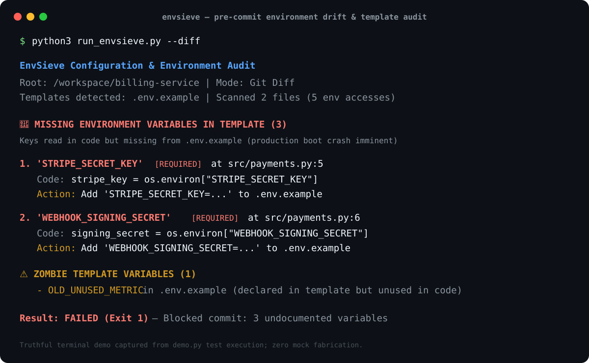

# EnvSieve 🛡️🔍

> **Zero-dependency pre-commit and CI verification check that audits source code for environment variable accesses (`os.environ`, `os.getenv`, `process.env`, `import.meta.env`) and reconciles them against `.env.example`, `.env.template`, and Dockerfiles before your code crashes production.**

[]()
[-blue.svg)]()
[]()
[]()

---


*Figure 1: Conceptual illustration of EnvSieve statically filtering code environment lookups against configuration templates.*

---


*Figure 2: Truthful, reproducible terminal output captured from `demo.py` execution.*

---

## The Problem: The Missing Environment Variable Trap

When developers or AI coding agents (Claude Code, Cursor, Copilot, Antigravity) build new features, they often introduce new environment variables (`os.environ["PAYMENT_SECRET"]`, `process.env.REDIS_URL`, etc.). 

1. **Local Success**: The developer has the variable set in their private local `.env` file. Tests pass.
2. **Template Drift**: They forget to document the new key in `.env.example` or staging configs.
3. **CI Passes**: Unit tests pass because the new codepath is mocked or skipped in CI.
4. **Production Crash**: The deployment hits production. The application boots, cannot find the key, and immediately crashes with `KeyError` or throws an `undefined` runtime exception during user traffic.
5. **Zombie Keys & Leaks**: Conversely, obsolete variables linger in templates for years, while accidental secrets (live Stripe keys, API tokens) get committed directly into template files.

**EnvSieve** eliminates this drift in < 30ms by statically cross-referencing your code's variable lookups against your repository's template files.

---

## Features

- ⚡ **Zero External Dependencies**: Pure Python standard library (`ast`, `re`, `pathlib`, `json`). No external pip dependencies needed.
- 🔍 **Safe AST & Token Parsing**: Uses native Python AST and JS/TS regex tokenizers. Never runs, imports, or executes untrusted code.
- 🎯 **Multi-Language Support**:
  - **Python**: `os.environ["KEY"]`, `os.environ.get("KEY")`, `os.getenv("KEY")`, `environ.get("KEY")`.
  - **JavaScript / TypeScript / Node**: `process.env.KEY`, `process.env['KEY']`.
  - **Frontend (Vite / Next.js)**: `import.meta.env.VITE_KEY`, `import.meta.env['KEY']`.
- 📁 **Template & Container Awareness**: Automatically parses `.env.example`, `.env.template`, `.env.sample`, `example.env`, and `Dockerfile` (`ENV` and `ARG`).
- 🔒 **Secret Leak Detection**: Alerts if a live credential (such as `sk_live_...`, `ghp_...`, `AKIA...`) is exposed in a template file.
- 🧟 **Zombie Key Warnings**: Identifies variables declared in `.env.example` that are never referenced in your application.
- ⏱️ **Git Diff Mode (`--diff`)**: Runs in < 20ms over uncommitted git changes, making it ideal as a zero-friction git pre-commit hook.
- 📊 **Actionable Outputs**: Colored terminal output, structured JSON reports (`--output-json`), and GitHub PR review Markdown cards (`--output-md`).

---

## Quick Start

### 1. Run Directly (No Install Needed)

```bash
# Audit the current repository
python3 run_envsieve.py

# Or audit only uncommitted git changes (pre-commit check)
python3 run_envsieve.py --diff

# Generate JSON and Markdown reports
python3 run_envsieve.py --output-json env-report.json --output-md env-report.md
```

### 2. Run the Interactive Demo

To see EnvSieve simulate baseline code, inject an AI-introduced missing environment variable, and block the CI gate:

```bash
python3 demo.py
```

---

## CLI Usage

```text
usage: envsieve [-h] [--version] [--path PATH] [--diff] [--base BASE]
                [--json] [--output-json FILE] [--output-md FILE] [--strict]

EnvSieve: Zero-dependency environment variable and .env.example drift detector.

options:
  -h, --help            show this help message and exit
  --version             show program's version number and exit
  --path PATH, -p PATH  Root directory of repository to audit (default: .)
  --diff, -d            Analyze only modified/added files in git diff
  --base BASE           Git base reference for comparison (e.g. 'main', 'HEAD~1')
  --json                Print report as JSON to stdout
  --output-json FILE    Write JSON report to specified file path
  --output-md FILE      Write Markdown review card to specified file path
  --strict              Fail with exit code 1 if zombie variables are found
```

---

## CI/CD & Pre-Commit Integration

### GitHub Actions Workflow (`.github/workflows/envsieve.yml`)

Add EnvSieve as an instant pre-build validation step:

```yaml
name: Environment Configuration Gate
on: [push, pull_request]

jobs:
  check-env-drift:
    runs-on: ubuntu-latest
    steps:
      - uses: actions/checkout@v4
      - name: Set up Python
        uses: actions/setup-python@v5
        with:
          python-version: "3.12"
      - name: Run EnvSieve
        run: python3 run_envsieve.py --strict --output-md env-card.md
```

### Git Pre-Commit Hook (`.git/hooks/pre-commit`)

```bash
#!/usr/bin/env sh
python3 run_envsieve.py --diff
```

---

## Running Automated Tests

EnvSieve includes 11 automated unit and integration tests covering Python AST parsing, JS token extraction, template parsing, secret detection, and CLI exit codes:

```bash
PYTHONPATH=src python3 -m unittest discover -s tests -v
```

---

## Limitations

- Performs **static analysis**. Dynamic environment variable lookups like `os.getenv(f"KEY_{name}")` or `process.env[dynamicVar]` cannot be resolved statically.
- Does not substitute for runtime environment validation or secret managers (e.g. AWS Secrets Manager, HashiCorp Vault). EnvSieve specifically guarantees synchronization between your source code and documentation/templates.

---

## License

MIT © 2026 EnvSieve Contributors
